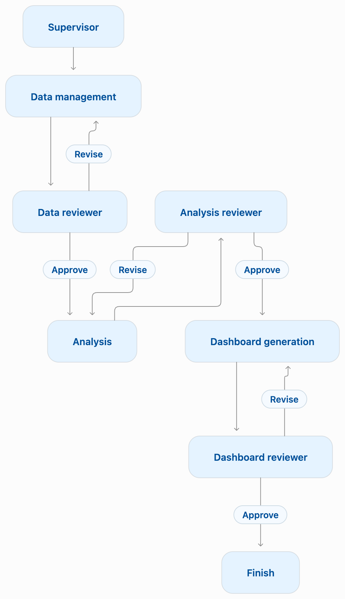

# Interactive-Multi-Agent-System

****Stage 1.** Model Client**
Python reached your local model, received a completed response, and the model correctly acknowledged that it had no dataset.

The setup runs Qwen3.5-0.8B-Q8_0 locally using llama.cpp. We’ll reuse the same loaded model for all agent roles, so no paid cloud API is required.

| Stage | What We build | Main challenge |
|---|---|---|
| 1. Model connection | A small Python client | Distinguishing incomplete output from a usable answer |
| 2. Tools from scratch | Inspection and statistical functions | Validating arguments and handling missing data |
| 3. Agent loop | Model chooses a tool, receives results, and continues | Wrong tool choices, invented answers, repeated calls |
| 4. LangChain integration | Tool definitions and native tool-call messages | Understanding what the framework handles—and what it does not |
| 5. LangGraph coordination | Supervisor, specialists, shared state, conditional edges | Passing the correct data and controlling execution |
| 6. Review and evaluation | Reviewers, bounded revisions, human approval, test cases | Checking correctness without trusting another model blindly |

The finished prototype will support one dataset at a time, inspection, descriptive and grouped analysis, a local dashboard, and bounded review loops. Cleaning will require an explicit policy and human approval. Broader statistics and deployment can come later.

We’ll distinguish a model limitation, a prompt problem, a tool bug, and a workflow bug

if a model prints a JSON request, the function has not executed yet. Indeed, the model has requested a tool call. Python must validate the request, execute the function, and return its result.

Use llama-server, rather than llama-cli, because Python needs the HTTP interface.

**Stage 2. Build tools independently of the model**
A tool begins as an ordinary Python function. We’ll verify its behavior first, then let the model request it.

INSPECTION:
{
  "row_count": 5,
  "columns": [
    "customer_type",
    "order_id",
    "order_value_eur"
  ],
  "missing_counts": {
    "customer_type": 0,
    "order_id": 0,
    "order_value_eur": 1
  }
}

CALCULATION:
{
  "column": "order_value_eur",
  "mean": 125.0,
  "values_used": 4,
  "missing_excluded": 1
}

**Stage 2. Build a tool registry**
A tool registry maps permitted names to Python functions. It lets our application turn a structured request into an actual function call.

REQUEST:
{
  "tool": "calculate_mean",
  "arguments": {
    "column": "order_value_eur"
  }
}
RESULT:
{
  "ok": true,
  "result": {
    "column": "order_value_eur",
    "mean": 125.0,
    "values_used": 4,
    "missing_excluded": 1
  }
}

REQUEST:
{
  "tool": "calculate_mean",
  "arguments": {
    "column": "customer_type"
  }
}
RESULT:
{
  "ok": false,
  "error": {
    "type": "ValueError",
    "message": "Column 'customer_type' is not numeric."
  }
}
The executor calculates a valid request and returns an understandable error for an invalid one.

**Stage 3: Let the model request a tool**
We’ll first make one model decision, then execute its request. Once that works, we’ll add the loop that returns observations to the model.

**Your question: What is the average order value?**

MODEL OUTPUT:
{"tool": "calculate_mean", "arguments": {"column": "order_value_eur"}}

APPLICATION RESULT:
{
  "ok": true,
  "result": {
    "column": "order_value_eur",
    "mean": 125.0,
    "values_used": 4,
    "missing_excluded": 1
  }
}

| Component | Responsibility |
|---|---|
| Model | Request `calculate_mean` for `order_value_eur` |
| Parser | Convert the returned JSON text into a dictionary |
| Executor | Validate the tool and arguments |
| Python function | Calculate €125 from four recorded values |

This is manual tool calling: the model generates ordinary text following our JSON convention. We have not introduced native API tool calls or an autonomous loop yet.

The model chose the right tool, and Python calculated the correct result. Now we’ll return that result to the model and let it decide whether to request another tool or finish.
**Stage 3: Add the agent loop**
**question 1:** What is the average order value?

MODEL OUTPUT:
{"tool": "calculate_mean", "arguments": {"column": "order_value_eur"}}

APPLICATION RESULT:
{
  "ok": true,
  "result": {
    "column": "order_value_eur",
    "mean": 125.0,
    "values_used": 4,
    "missing_excluded": 1
  }
}

**Your question 2:** How many orders are there, and what is their average recorded value?

The intended behavior is to inspect the dataset, calculate the mean, and then answer. Either tool order is acceptable here.

What makes this a loop? After each tool result, Python calls the model again with the accumulated observations. The model chooses its next action; Python limits execution to five decisions.

Two limitations remain deliberately visible:
- A successful tool call does not prove that every part of the question was answered.
- The model’s final explanation can still misreport correct tool results.
We’ll evaluate those separately rather than treating "ok": true as proof of correctness.

STEP 1 — MODEL:
{"tool": "calculate_mean", "arguments": {"column": "order_value_eur"}}
APPLICATION FEEDBACK:
{
  "ok": true,
  "result": {
    "column": "order_value_eur",
    "mean": 125.0,
    "values_used": 4,
    "missing_excluded": 1
  }
}

STEP 2 — MODEL:
{"tool": "calculate_mean", "arguments": {"column": "order_value_eur"}}
APPLICATION FEEDBACK:
{
  "ok": true,
  "result": {
    "column": "order_value_eur",
    "mean": 125.0,
    "values_used": 4,
    "missing_excluded": 1
  }
}

STEP 3 — MODEL:
{"tool": "calculate_mean", "arguments": {"column": "order_value_eur"}}
APPLICATION FEEDBACK:
{
  "ok": true,
  "result": {
    "column": "order_value_eur",
    "mean": 125.0,
    "values_used": 4,
    "missing_excluded": 1
  }
}

STEP 4 — MODEL:
{"tool": "calculate_mean", "arguments": {"column": "order_value_eur"}}
APPLICATION FEEDBACK:
{
  "ok": true,
  "result": {
    "column": "order_value_eur",
    "mean": 125.0,
    "values_used": 4,
    "missing_excluded": 1
  }
}

STEP 5 — MODEL:
{"tool": "calculate_mean", "arguments": {"column": "order_value_eur"}}
APPLICATION FEEDBACK:
{
  "ok": true,
  "result": {
    "column": "order_value_eur",
    "mean": 125.0,
    "values_used": 4,
    "missing_excluded": 1
  }
}

APPLICATION RESULT:
{
  "ok": false,
  "reason": "Maximum number of decisions reached.",
  "observations": [
    {
      "ok": true,
      "result": {
        "column": "order_value_eur",
        "mean": 125.0,
        "values_used": 4,
        "missing_excluded": 1
      }
    },
    {
      "ok": true,
      "result": {
        "column": "order_value_eur",
        "mean": 125.0,
        "values_used": 4,
        "missing_excluded": 1
      }
    },
    {
      "ok": true,
      "result": {
        "column": "order_value_eur",
        "mean": 125.0,
        "values_used": 4,
        "missing_excluded": 1
      }
    },
    {
      "ok": true,
      "result": {
        "column": "order_value_eur",
        "mean": 125.0,
        "values_used": 4,
        "missing_excluded": 1
      }
    },
    {
      "ok": true,
      "result": {
        "column": "order_value_eur",
        "mean": 125.0,
        "values_used": 4,
        "missing_excluded": 1
      }
    }
  ]
}

The calculation is correct, but the agent is stuck repeating the same action. It never requested the order count or produced a final answer. The five-step limit correctly stopped execution.

This is a decision-loop failure, not a calculation error. Our prompt said “don’t repeat,” but Python did not enforce that rule.

Let’s add duplicate-call protection and give the model explicit feedback about completed work.

I addressed the repeated tool calls by adding a record of successful requests and their results. Before executing a request, Python checks whether the exact same tool and arguments have already succeeded. If they have, it blocks execution and returns feedback containing the previous result, asking the model to choose another action or finish. I also included completed calls in the model’s instructions so it can see what has already been done, while keeping the five-step limit to prevent an endless loop. This prevents duplicate calculations, but we still need to test whether the model uses the feedback to complete the task.

Your question: How many orders are there, and what is their average recorded value?

STEP 1 — MODEL:
{"tool": "calculate_mean", "arguments": {"column": "order_value_eur"}}
APPLICATION FEEDBACK:
{
  "ok": true,
  "result": {
    "column": "order_value_eur",
    "mean": 125.0,
    "values_used": 4,
    "missing_excluded": 1
  }
}

STEP 2 — MODEL:
{"tool": "calculate_mean", "arguments": {"column": "order_value_eur"}}
APPLICATION FEEDBACK:
{
  "ok": false,
  "error": "Duplicate call rejected. This operation already succeeded. Use its result instead of repeating it.",
  "previous_result": {
    "column": "order_value_eur",
    "mean": 125.0,
    "values_used": 4,
    "missing_excluded": 1
  }
}

STEP 3 — MODEL:
{"tool": "calculate_mean", "arguments": {"column": "order_value_eur"}}
APPLICATION FEEDBACK:
{
  "ok": false,
  "error": "Duplicate call rejected. This operation already succeeded. Use its result instead of repeating it.",
  "previous_result": {
    "column": "order_value_eur",
    "mean": 125.0,
    "values_used": 4,
    "missing_excluded": 1
  }
}

STEP 4 — MODEL:
{"tool": "calculate_mean", "arguments": {"column": "order_value_eur"}}
APPLICATION FEEDBACK:
{
  "ok": false,
  "error": "Duplicate call rejected. This operation already succeeded. Use its result instead of repeating it.",
  "previous_result": {
    "column": "order_value_eur",
    "mean": 125.0,
    "values_used": 4,
    "missing_excluded": 1
  }
}

STEP 5 — MODEL:
{"tool": "calculate_mean", "arguments": {"column": "order_value_eur"}}
APPLICATION FEEDBACK:
{
  "ok": false,
  "error": "Duplicate call rejected. This operation already succeeded. Use its result instead of repeating it.",
  "previous_result": {
    "column": "order_value_eur",
    "mean": 125.0,
    "values_used": 4,
    "missing_excluded": 1
  }
}

APPLICATION RESULT:
{
  "ok": false,
  "reason": "Maximum number of decisions reached.",
  "observations": [
    {
      "ok": true,
      "result": {
        "column": "order_value_eur",
        "mean": 125.0,
        "values_used": 4,
        "missing_excluded": 1
      }
    }
  ]
}

Python calculated the mean only once. But the model still failed to choose a new action. This test shows that feedback alone did not make your small model complete the task.

I addressed the repeated tool calls by replacing the open-ended agent loop with a constrained workflow. The model now classifies the request once—for example, as count_and_mean—and Python maps that classification to a predefined sequence of tools. In this run, Python executed dataset inspection and mean calculation once each, then constructed the final answer directly from their results: five orders and an average recorded value of €125, with one missing value excluded. This reduced the model’s autonomy while giving the application control over execution order, stopping, and numerical reporting.

Your question: How many orders are there, and what is their average recorded value?

MODEL CLASSIFICATION:
{"task": "count_and_mean"}

TOOL: inspect_dataset
{
  "ok": true,
  "result": {
    "row_count": 5,
    "columns": [
      "customer_type",
      "order_id",
      "order_value_eur"
    ],
    "missing_counts": {
      "customer_type": 0,
      "order_id": 0,
      "order_value_eur": 1
    }
  }
}

TOOL: calculate_mean
{
  "ok": true,
  "result": {
    "column": "order_value_eur",
    "mean": 125.0,
    "values_used": 4,
    "missing_excluded": 1
  }
}

APPLICATION RESULT:
{
  "ok": true,
  "task": "count_and_mean",
  "answer": "There are 5 orders. The average recorded order value is \u20ac125.00, based on 4 recorded values, with 1 missing value(s) excluded.",
  "results": {
    "inspect_dataset": {
      "row_count": 5,
      "columns": [
        "customer_type",
        "order_id",
        "order_value_eur"
      ],
      "missing_counts": {
        "customer_type": 0,
        "order_id": 0,
        "order_value_eur": 1
      }
    },
    "calculate_mean": {
      "column": "order_value_eur",
      "mean": 125.0,
      "values_used": 4,
      "missing_excluded": 1
    }
  }
}

We implemented a model-driven loop in stage 3.

**Stage 4 of 6: Introduce LangChain tools**
Until now, we manually defined tool metadata and checked function arguments. LangChain’s @tool wrapper can generate an input schema from a function’s type hints and provide a standard .invoke() interface. It does not improve the model’s decisions automatically.

**python -m pip install "langchain-core>=1,<2"**

I wrapped our existing Python functions as LangChain tools using the @tool decorator, keeping the calculations unchanged. LangChain uses each function’s name, description, and type hints to generate an input schema and provides a standard .invoke() method for execution. For example, calculate_mean requires a string argument called column, so a request without that argument is rejected before the calculation runs. The underlying Python function still checks whether the column exists and contains numeric data. This step introduces LangChain’s tool interface; it does not yet involve the model or native tool calling.

python langchain_tools.py
TOOL NAME:
calculate_mean

TOOL DESCRIPTION:
Calculate a numeric column's mean, excluding missing values.

INPUT SCHEMA:
{
  "description": "Calculate a numeric column's mean, excluding missing values.",
  "properties": {
    "column": {
      "title": "Column",
      "type": "string"
    }
  },
  "required": [
    "column"
  ],
  "title": "calculate_mean",
  "type": "object"
}

VALID EXECUTION:
{
  "column": "order_value_eur",
  "mean": 125.0,
  "values_used": 4,
  "missing_excluded": 1
}

INVALID EXECUTION:
ValidationError
1 validation error for calculate_mean
column
  Field required [type=missing, input_value={}, input_type=dict]
    For further information visit https://errors.pydantic.dev/2.14/v/missing

I converted the existing mean-calculation function into a LangChain tool using @tool. LangChain generated its name, description, and input schema, which specifies that a string argument called column is required. Calling .invoke({"column": "order_value_eur"}) successfully executed the Python function and returned a mean of €125 from four recorded values, excluding one missing value. Calling .invoke({}) produced a validation error because the required argument was absent. This verified tool execution and input validation; the model was not involved yet.

Both checks passed: the tool returned €125 for valid input and rejected a missing argument.
**Stage 4: Native tool calling**
Previously, the model printed ordinary JSON that we parsed ourselves. Now we’ll test the API’s structured tool_calls field.

For this first experiment, we explicitly require calculate_mean. We’re testing the protocol—not independent tool selection.

In native_tool_call.py, we connected LangChain to your local Qwen model through llama-server. The script first retrieves the model’s ID, then uses bind_tools() to send the description and input schema of calculate_mean to the model. For this experiment, we explicitly require that tool, so we are testing native tool calling rather than letting the model choose between tools. The script reads the structured request from reply.tool_calls, checks that it contains exactly one valid request for calculate_mean, and executes it in Python using .invoke(call). LangChain returns a ToolMessage containing the calculation result and the matching tool_call_id, which links the result to its request. The script prints that result; it does not yet send it back to the model for a final explanation.

**python -m pip install "langchain-openai>=1,<2"**

python native_tool_call.py
MODEL TEXT:

NATIVE TOOL REQUESTS:
[
  {
    "name": "calculate_mean",
    "args": {
      "column": "order_value_eur"
    },
    "id": "ooe5Dzxsgbb2MEaqRUllyu2rkw5WP2a8",
    "type": "tool_call"
  }
]

RESULT MESSAGE TYPE:
ToolMessage

MATCHING TOOL CALL ID:
ooe5Dzxsgbb2MEaqRUllyu2rkw5WP2a8

TOOL RESULT:
{"column": "order_value_eur", "mean": 125.0, "values_used": 4, "missing_excluded": 1}
(.venv) minahosseini@Minas-MacBook-Air agent_course_v2 % 

Native tool calling worked with your local model.
- Qwen returned a structured request for calculate_mean.
- Python executed the function and calculated €125.
- LangChain returned a ToolMessage with the same call ID, linking the result to the request.
The empty MODEL TEXT is expected here: the response contained a tool request rather than a written answer. Remember, we explicitly required this tool; this test did not measure independent tool selection.

python native_tool_call.py
MODEL TEXT:

NATIVE TOOL REQUESTS:
[
  {
    "name": "calculate_mean",
    "args": {
      "column": "order_value_eur"
    },
    "id": "BJB197EHj1bm4D4Gt2q89mILEI5NuO8o",
    "type": "tool_call"
  }
]

RESULT MESSAGE TYPE:
ToolMessage

MATCHING TOOL CALL ID:
BJB197EHj1bm4D4Gt2q89mILEI5NuO8o

TOOL RESULT:
{"column": "order_value_eur", "mean": 125.0, "values_used": 4, "missing_excluded": 1}

FINAL ANSWER:
The average recorded order value is **125.0 EUR**.
*   **Values used**: 4
*   **Missing values excluded**: 1

I added a second request that sends the tool result back to the local model, together with the user’s question and the model’s original tool request. The ToolMessage includes the matching call ID, so the model can associate the calculation result with its request. I instructed it to explain only the observed result: an average order value of €125, calculated from four recorded values, with one missing value excluded. I also added checks for an empty or truncated explanation. This completes the sequence of requesting a tool, executing it in Python, and returning its result to the model for a final answer.

The local model requested a native tool call, Python executed it, and the model accurately explained the result.

**Stage 5 of 6: Coordinate execution with LangGraph**
We’ll move the working count-and-mean workflow into a graph

| Concept | Meaning in this example |
|---|---|
| **State** | Question, task classification, tool results, and answer |
| **Node** | A function that performs one workflow step |
| **Conditional edge** | A rule choosing which node runs next |

LangGraph manages state updates and transitions between nodes. GitHub

For this first graph, the supervisor uses the classification approach that already worked. The worker nodes execute LangChain tools directly. They are not yet independently reasoning specialist agents.

**python -m pip install "langgraph>=1,<2"**

In supervisor_graph.py, I organized the working customer-order workflow into four LangGraph nodes: supervisor, data management, analysis, and reporting. The supervisor asks your local model to classify the question as a count, a mean, both, or unsupported. Conditional edges use that classification to choose which nodes run—for example, a request for both goes through inspection and calculation before reporting. The worker nodes execute the LangChain tools directly, and their results are stored in shared state alongside the question and task. The reporting node constructs the answer from those results, then the graph ends. This gives Python explicit control over execution order and stopping; the worker nodes are not yet independently reasoning agents.

python supervisor_graph.py
Your question: How many orders are there, and what is their average recorded value?

NODE UPDATE:
{
  "supervisor": {
    "task": "count_and_mean"
  }
}

NODE UPDATE:
{
  "data_management": {
    "inspection": {
      "row_count": 5,
      "columns": [
        "customer_type",
        "order_id",
        "order_value_eur"
      ],
      "missing_counts": {
        "customer_type": 0,
        "order_id": 0,
        "order_value_eur": 1
      }
    }
  }
}

NODE UPDATE:
{
  "analysis": {
    "calculation": {
      "column": "order_value_eur",
      "mean": 125.0,
      "values_used": 4,
      "missing_excluded": 1
    }
  }
}

NODE UPDATE:
{
  "reporting": {
    "answer": "There are 5 orders. The average recorded order value is €125.00, using 4 recorded values and excluding 1 missing value(s)."
  }
}

The graph worked correctly: the supervisor selected count_and_mean, both tools ran, and reporting used their results to produce the correct answer.

The node updates show how shared state accumulates:
- Supervisor adds the task classification.
- Data management adds the inspection result.
- Analysis adds the calculation result.
- Reporting reads those fields and adds the answer.
Let’s verify that the conditional edges actually choose different paths, rather than always running every node.

**Test:** I added two checks to verify that the graph runs only the steps needed for each question. For an order-count request, the supervisor should route to data management and then reporting, skipping analysis. For an average-value request, it should route to analysis and then reporting, skipping data management. No code was changed; these tests check whether the conditional edges follow the supervisor’s classification correctly, rather than always running every node.

I added a dashboard tool that creates a local HTML page from the order count and average-value results already calculated by Python. The tool checks that recorded and missing values add up to the total order count. I then extended the supervisor to recognize dashboard requests and added conditional edges so those requests run inspection, analysis, and dashboard generation before reporting. The dashboard node reads the earlier results from shared state, creates the page, and stores its file path back in the state. This is currently a predefined workflow step, not an agent independently designing a dashboard, and we still need to test the new path.

**Debugging:** I added diagnostic prints to show the supervisor’s exact response and the dictionary produced after parsing it. I also asked you to check that "dashboard" is included among the permitted task labels. This helps distinguish whether the model returned an unexpected classification or our validation code rejected a valid dashboard request.

Stage 6 of 6: Add a reviewer and bounded revision
We’ll start with one reporting agent and one reviewer agent, reusing your existing graph and tools.

The reporting agent writes an explanation from the tool results. The reviewer checks it against those results:
- Approve: finish.
- Revise: return feedback to the reporting agent.
- Two rejected drafts: stop and report failure.
Both agents use your same local model with different instructions. A second model opinion is not proof of correctness, so we’ll test its behavior afterward.

In Stage 6, I changed reporting from a fixed Python answer template into a model-based reporting agent. It receives the question and tool results and writes a draft. I then added a separate reviewer role that receives the draft and the same evidence and returns a structured decision: approve or revise, with a reason. LangGraph stores that feedback in shared state and uses conditional edges to decide what happens next. Approval ends the workflow; revision sends the feedback back to reporting so it can produce another draft. An attempt counter allows at most two drafts, preventing an endless review loop. Both roles use your same local Qwen model with different instructions, so the reviewer provides an additional check—not a guarantee of correctness.

python supervisor_graph.py
Your question: How many orders are there, and what is their average recorded value?

RAW SUPERVISOR RESPONSE:
'{"task": "count_and_mean"}'
PARSED CLASSIFICATION:
{
  "task": "count_and_mean"
}

NODE UPDATE:
{
  "supervisor": {
    "task": "count_and_mean"
  }
}

NODE UPDATE:
{
  "data_management": {
    "inspection": {
      "row_count": 5,
      "columns": [
        "customer_type",
        "order_id",
        "order_value_eur"
      ],
      "missing_counts": {
        "customer_type": 0,
        "order_id": 0,
        "order_value_eur": 1
      }
    }
  }
}

NODE UPDATE:
{
  "analysis": {
    "calculation": {
      "column": "order_value_eur",
      "mean": 125.0,
      "values_used": 4,
      "missing_excluded": 1
    }
  }
}

NODE UPDATE:
{
  "reporting": {
    "answer": "Based on the provided data, there are 5 orders in total. The average recorded value for these orders is 125.0 EUR. The calculation excludes 1 missing value, and the dashboard was not created.",
    "report_attempts": 1,
    "status": "draft"
  }
}

NODE UPDATE:
{
  "reviewer": {
    "review_verdict": "approve",
    "review_feedback": "The draft answers the question by stating there are 5 orders and an average value of 125.0 EUR. The numbers (5 orders, 125.0 EUR) are consistent with the tool evidence. The missing value count is correctly identified as 1, and the calculation excludes it as specified. No unsupported claims are made.",
    "status": "completed"
  }
}
(.venv) minahosseini@Minas-MacBook-Air agent_course_v2 % 

The review mechanism worked: reporting produced a draft, the reviewer approved it, and the graph finished.

**But the reviewer missed an omission:** the draft did not explicitly say that the mean used four recorded values, although we required that. This shows why a model’s approval alone is insufficient.
**Test whether the reviewer catches an obvious error**
We’ll deliberately corrupt only the first draft, leaving the actual data and calculations unchanged.

The intended sequence is:
1. Reporting produces the deliberately incorrect draft.
2. Reviewer returns revise, identifying the incorrect count and mean.
3. LangGraph returns to reporting with the feedback.
4. Reporting generates a second draft from the correct tool evidence.
5. Reviewer approves it—or the graph stops after the second rejection.
If the reviewer approves the incorrect draft, that is a failed review test, even if the graph reports completed.

I proposed a controlled test to see whether the reviewer could detect and correct an obvious error. The temporary code replaces only the first report with a deliberately wrong claim of 999 orders and a €999 average, while leaving the actual data and tool results unchanged. I also strengthened the reviewer’s instructions to require the number of recorded values used and missing values excluded. The expected behavior is that the reviewer rejects the incorrect draft, LangGraph sends its feedback back to reporting, and the reporting agent produces a corrected second draft. We have not yet confirmed that this test succeeds; the temporary error code should be removed afterward.

**diagnostic:** I added diagnostic prints inside the reviewer function to show the model’s exact response and the dictionary produced after parsing it. This will reveal why validation failed—for example, a missing reason field, an unexpected verdict, or an incorrect value type. I kept the deliberately wrong draft so we can repeat the same test. This change does not fix the reviewer yet; it makes the failure visible so we can correct the actual problem.

I changed the reporting agent to return structured numerical claims instead of free-form text, then added a Python check that compares each claim with the actual tool results. If fields are missing or numbers are wrong—such as 999 orders instead of five—Python rejects the draft and sends precise corrections back to reporting. Only claims that pass these checks proceed to the model reviewer, whose response was simplified to approve or revise. After approval, Python constructs the final written answer from the verified claims. The two-attempt limit remains, so the workflow stops if revision fails. This prevents a mistaken model approval from overriding a numerical mismatch, although the underlying tools still need separate testing.

The correction loop passed this test.
1. The first draft contained the deliberately incorrect 999 orders and €999 mean.
2. Python’s checks, not the model, detected both mismatches and returned precise feedback.
3. Reporting produced the correct second draft.
4. The numerical checks passed, the model approved, and Python rendered the final answer.

**This completes the six-stage core build: local inference, Python tools, agent-loop experiments, LangChain and native tool calling, LangGraph routing, and bounded review with numerical validation.**

The demonstrated lesson: model feedback can help revision, but enforceable Python checks prevented incorrect numbers from being accepted. This successful example does not yet establish reliability across other questions or datasets.

****reliablity****
Make it reliable by checking each layer independently. Your latest safeguard proves that a report matches the tool results—but a wrong tool or a buggy calculation could still produce the wrong answer.

For your current application, I would prioritize these checks:

| Layer | What to verify | Example failure |
|---|---|---|
| **Request understanding** | Supervisor chose the correct task | User asks for a count; model selects a mean |
| **Tool selection** | Correct function and column were used | Mean calculated for the wrong numeric column |
| **Calculation** | Python functions match independently known answers | Missing values incorrectly treated as zero |
| **Data identity** | Every component uses the intended dataset | Dashboard uses original data after cleaning |
| **Reporting** | Required facts match tool evidence | Report says €999 instead of €125 |
| **Execution** | Failures stop safely and retries are bounded | Repeated calls or endless revisions |

**First**, test the Python tools without any model. Use small datasets whose answers you can calculate yourself. Include missing values, zero values, negative values, text columns, unknown columns, and columns where every value is missing. Your current €125 example is one test—not enough to establish general correctness.

**Second**, measure the model’s decisions separately. Create a small collection of questions with expected classifications, including paraphrases and unsupported requests:
Question	Expected classification
“How many orders are there?”	count
“What is the average recorded order value?”	mean
“Give me the order count and average value.”	count_and_mean
“Create an order dashboard.”	dashboard
“Predict next month’s sales.”	unsupported

Record both classification accuracy and complete-task success. Agent evaluation should examine intermediate tool choices as well as final results. langchain-ai/langsmith-cookbook · GitHub

**Third**, keep important guarantees in Python. Continue enforcing permitted tools, argument schemas, required results, numerical consistency, and attempt limits. If validation fails, return a clear failure or ask for clarification. Never convert an invalid response into success just to keep the workflow moving.

**Fourth**, test failures deliberately. You already tested a wrong first draft. Also test an always-wrong draft: the graph must stop after two rejections. Test missing report fields, invalid reviewer JSON, unavailable server connections, and unsupported questions. Test individual nodes and the complete graph; LangGraph supports both approaches. GitHub

**Finally**, simplify where the model adds no value. In your current version, asking the model to copy four numbers into JSON creates another opportunity for error. For a numerical report, Python can construct the verified answer directly. Use the model where interpretation is useful, and treat a reviewer model as an additional opinion rather than the authority on correctness.

The next practical step is a local automated test suite—not another agent. It should give you evidence that a code or prompt change improves behavior without breaking cases that previously worked. All of this can run locally without paid APIs.

1. In the step before date validation, I extended your existing data_tools.py with validate_order_keys(rows). It checks the combined key (order_id, line_id), allowing different product lines within the same order while identifying invalid IDs, identical duplicate records, and conflicting records with the same key but different contents. The function reports problems without deleting or changing data. I also added eight automated tests in test_data_quality.py to verify those cases and confirm that the source remains unchanged. All eight tests passed on your Mac; the function has not yet been connected to the agent.

2. I added date validation to data_tools.py using an explicit rule: accept YYYY-MM-DD and DD.MM.YYYY, but reject other formats rather than guess their meaning. The function distinguishes valid dates, missing values, missing fields, incorrect types, and impossible dates such as February 30. It proposes an ISO-formatted date for accepted values without changing the source records. I also provided nine tests covering those cases, leap years, and source preservation. These extend your eight ID tests to 17 tests, but we have not yet seen the date-test results from your Mac.

   (.venv) minahosseini@Minas-MacBook-Air agent_course_v2 % python -m unittest test_data_quality -v
test_day_month_year_date (test_data_quality.TestOrderDates.test_day_month_year_date) ... ok
test_impossible_date (test_data_quality.TestOrderDates.test_impossible_date) ... ok
test_iso_date (test_data_quality.TestOrderDates.test_iso_date) ... ok
test_leap_year (test_data_quality.TestOrderDates.test_leap_year) ... ok
test_missing_field (test_data_quality.TestOrderDates.test_missing_field) ... ok
test_missing_values (test_data_quality.TestOrderDates.test_missing_values) ... ok
test_numeric_value_rejected (test_data_quality.TestOrderDates.test_numeric_value_rejected) ... ok
test_slash_format_is_not_guessed (test_data_quality.TestOrderDates.test_slash_format_is_not_guessed) ... ok
test_source_data_preserved (test_data_quality.TestOrderDates.test_source_data_preserved) ... ok
test_conflicting_quantity_is_detected (test_data_quality.TestOrderKeys.test_conflicting_quantity_is_detected) ... ok
test_different_lines_in_same_order_are_valid (test_data_quality.TestOrderKeys.test_different_lines_in_same_order_are_valid) ... ok
test_empty_dataset (test_data_quality.TestOrderKeys.test_empty_dataset) ... ok
test_empty_or_padded_order_ids_are_rejected (test_data_quality.TestOrderKeys.test_empty_or_padded_order_ids_are_rejected) ... ok
test_exact_duplicate_is_detected (test_data_quality.TestOrderKeys.test_exact_duplicate_is_detected) ... ok
test_invalid_line_ids_are_rejected (test_data_quality.TestOrderKeys.test_invalid_line_ids_are_rejected) ... ok
test_missing_order_id_is_detected (test_data_quality.TestOrderKeys.test_missing_order_id_is_detected) ... ok
test_source_data_is_preserved (test_data_quality.TestOrderKeys.test_source_data_is_preserved) ... ok

----------------------------------------------------------------------
Ran 17 tests in 0.003s

OK

3.We added a deduplication function that removes exact duplicate order lines, keeps conflicting records and invalid IDs for review, and preserves the original data. It also records which rows were removed and which copies were retained. We added seven tests covering these rules, including checking that running the function twice makes no further changes. These new tests still need to be run.

4. We added a numeric validator that distinguishes valid numbers from missing values, text, booleans, NaN, and infinity without changing the data. We also added six tests to check these cases and source preservation. This prepares the data for reliable correlation analysis; the new tests still need to be run.
Your numeric validator correctly handled the tested cases: ordinary numbers, missing values, text, booleans, NaN, and infinity, while preserving the source data.

Our policy is:
- Keep a row when both values are valid numbers.
- Exclude a row if either value is missing, and record why.
- Reject the preparation if a field is absent or contains invalid data. We won’t silently discard data-quality problems.

We added a function that prepares two numeric columns for correlation while keeping values from the same row together. It excludes pairs with missing values and records why, but blocks analysis if it finds invalid data or absent fields. We also added seven tests for alignment, exclusions, invalid inputs, and source preservation. These new tests still need to be run.

We added a function to calculate Pearson, Spearman, or Kendall correlation using SciPy. It reuses our validated pairs, records missing-value exclusions, and rejects invalid data, constant columns, fewer than three complete pairs, or numerical problems. We also added ten tests using known relationships to check the calculations and source preservation. These tests still need to be run; p-values and hypothesis testing come later.

**Also, returning {"ok": False} does not automatically stop your entire agent workflow. When we connect these tools to LangGraph, we must explicitly make the graph check that flag and route to an error or clarification response instead of continuing with the analysis.**

python demo_reliability.py

--- Valid data ---
ANALYSIS SUCCEEDED:
{
  "method": "pearson",
  "x_column": "x",
  "y_column": "y",
  "pairs_used": 3,
  "included_rows": [
    1,
    2,
    3
  ],
  "excluded_rows": [],
  "ok": true,
  "coefficient": 0.9999999999999998
}

--- One missing value ---
ANALYSIS SUCCEEDED:
{
  "method": "pearson",
  "x_column": "x",
  "y_column": "y",
  "pairs_used": 3,
  "included_rows": [
    1,
    3,
    4
  ],
  "excluded_rows": [
    {
      "row": 2,
      "reason": "missing_value",
      "columns": [
        "y"
      ]
    }
  ],
  "ok": true,
  "coefficient": 1.0
}

--- Text inside a numeric column ---
ANALYSIS BLOCKED:
{
  "ok": false,
  "error": "Invalid data must be resolved before analysis.",
  "invalid_values": [
    {
      "row": 2,
      "column": "y",
      "reason": "not_numeric"
    }
  ]
}

--- Constant column ---
ANALYSIS BLOCKED:
{
  "method": "pearson",
  "x_column": "x",
  "y_column": "y",
  "pairs_used": 3,
  "included_rows": [
    1,
    2,
    3
  ],
  "excluded_rows": [],
  "ok": false,
  "reason": "constant_column"
}

--- Unknown method ---
REQUEST REJECTED: Method must be 'pearson', 'spearman', or 'kendall'.

We created demo_reliability.py to demonstrate five situations: valid data, missing values, invalid text, a constant column, and an unknown method. It shows when analysis succeeds, when it is blocked with a reason, and how an exception is caught so the program can continue. This demonstrates how your application handles problems outside the automated tests.

All five cases behaved as intended:
- Valid data: correlation succeeded. 0.9999999999999998 is effectively 1.0; the tiny difference comes from floating-point arithmetic.
- Missing value: row 2 was excluded and recorded; the remaining three pairs were analysed.
- Text value: analysis was blocked, identifying row 2 and column y.
- Constant column: analysis was blocked because correlation is undefined without variation.
- Unknown method: the exception was caught and displayed without an uncontrolled crash.
Your checks now demonstrate both successful calculations and controlled rejection. Next, we’ll connect this behaviour to LangGraph so a failed tool result stops the analysis path and produces a clear explanation.

Your program handled all five situations correctly: it calculated correlation for valid data, excluded and recorded the missing pair, blocked text values and constant columns, and caught the unknown-method error without crashing. The value 0.9999999999999998 is effectively 1.0—the small difference is normal floating-point rounding. These results came from Python checks and SciPy; the LLM was not involved.

python demo_reliability.py

--- Valid data ---
ANALYSIS SUCCEEDED:
{
  "method": "pearson",
  "x_column": "x",
  "y_column": "y",
  "pairs_used": 3,
  "included_rows": [
    1,
    2,
    3
  ],
  "excluded_rows": [],
  "ok": true,
  "coefficient": 0.9999999999999998
}

--- One missing value ---
ANALYSIS SUCCEEDED:
{
  "method": "pearson",
  "x_column": "x",
  "y_column": "y",
  "pairs_used": 3,
  "included_rows": [
    1,
    3,
    4
  ],
  "excluded_rows": [
    {
      "row": 2,
      "reason": "missing_value",
      "columns": [
        "y"
      ]
    }
  ],
  "ok": true,
  "coefficient": 1.0
}

--- Text inside a numeric column ---
ANALYSIS BLOCKED:
{
  "ok": false,
  "error": "Invalid data must be resolved before analysis.",
  "invalid_values": [
    {
      "row": 2,
      "column": "y",
      "reason": "not_numeric"
    }
  ]
}

--- Constant column ---
ANALYSIS BLOCKED:
{
  "method": "pearson",
  "x_column": "x",
  "y_column": "y",
  "pairs_used": 3,
  "included_rows": [
    1,
    2,
    3
  ],
  "excluded_rows": [],
  "ok": false,
  "reason": "constant_column"
}

--- Unknown method ---
REQUEST REJECTED: Method must be 'pearson', 'spearman', or 'kendall'.

**Now we’ll test workflow reliability:** a failed calculation must never reach the successful-reporting node.

We’ll create a small graph in your existing folder first. Once verified, we can apply the same routing to supervisor_graph.py.

A conditional edge chooses the next node using the graph’s state—in this case, whether the tool returned ok: True

**These are integration tests: **
they check that your calculation function and LangGraph routing work together, including which nodes actually execute.

We connected your correlation function to a small LangGraph workflow. After calculation, a conditional edge checks the result: successful calculations go to reporting, while failed calculations go to a blocked-response node. We also added four integration tests to verify those routes, exception handling, and source preservation. All 51 tests passed; this protection is verified in the small graph but has not yet been added to your main supervisor graph.

